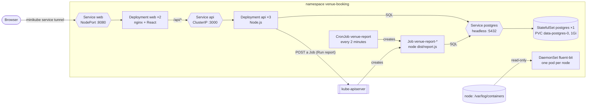

# Kubernetes deployment

Kustomize manifests for the Venue Booking System: `web` and `api` Deployments, a `postgres`
StatefulSet with a PVC, the `venue-report` CronJob (also the template for manual report Jobs) and a
`fluent-bit` DaemonSet. Everything lives in the `venue-booking` namespace.

Tested with minikube (docker driver, one node, StorageClass `standard`) and kubectl's built-in Kustomize.

## Architecture



Only `web` is reachable from outside the cluster. `api` and `postgres` have cluster-internal addresses only.
A report runs either when someone clicks "Run report" (the API asks Kubernetes to create a Job) or on the
CronJob's schedule. Both kinds of Job run the same worker and write the result to PostgreSQL.

## What each file is for

If you know Docker Compose: each `*.yaml` file below roughly matches one service in `compose.yaml`.
`kustomization.yaml` is the index that `kubectl apply -k` reads to apply them together.

| File                       | Contents                                                                                                 | Compose equivalent              |
| -------------------------- | -------------------------------------------------------------------------------------------------------- | ------------------------------- |
| `kustomization.yaml`       | Index: lists the files below, sets the namespace and image tags, generates the ConfigMaps and Secret     | the top of `compose.yaml`       |
| `namespace.yaml`           | The `venue-booking` namespace that holds everything                                                      | the Compose project name        |
| `web.yaml`                 | Frontend (`apps/web`): Deployment ×2 and the NodePort Service                                            | service `frontend`              |
| `api.yaml`                 | Backend (`apps/api`): Deployment ×3, ClusterIP Service, and the ServiceAccount + RBAC to start Jobs      | service `api`                   |
| `postgres.yaml`            | Database: StatefulSet ×1 with a 1Gi PVC, and its headless Service                                        | service `database` + its volume |
| `report-cronjob.yaml`      | Scheduled utilisation report; also the template for manual report Jobs                                   | none                            |
| `fluent-bit.yaml`          | Log collector: one pod per node reading container logs                                                   | none                            |
| `fluent-bit-pipeline.yaml` | Fluent Bit's own config file, turned into a ConfigMap                                                    | none                            |
| `config.env`               | Non-secret settings, turned into ConfigMap `app-config-<hash>`                                           | `.env`                          |
| `secret.env.example`       | Template for the gitignored `secret.env` (DB password), turned into Secret `postgres-credentials-<hash>` | `.env`                          |

## Prerequisites

- A running cluster: `minikube start`
- A POSIX shell: the commands below assume Git Bash or WSL on Windows
- Docker, and a `.env` in the repository root (`cp .env.example .env`): Compose needs it to build

## Deploy

```bash
# 1. Build both images and load them into the cluster (no registry).
IMAGE_TAG=2.0.0 docker compose build api frontend
minikube image load venue-booking/api:2.0.0 venue-booking/frontend:2.0.0

# 2. Create the database credentials (gitignored); change the password.
cp deploy/k8s/secret.env.example deploy/k8s/secret.env

# 3. Apply everything.
kubectl apply -k deploy/k8s

# 4. Open the UI. On Windows the node IP is not routable; keep this terminal open.
minikube service web -n venue-booking --url
```

## Verify

Run these in a second terminal, with `URL` set to the address `minikube service` printed.

```bash
URL=http://127.0.0.1:57385   # use the address your minikube service printed

kubectl -n venue-booking rollout status deploy/api deploy/web sts/postgres
kubectl -n venue-booking get deploy,sts,ds,cronjob,job,svc,cm,secret,pvc,pod -o wide

# Several API replicas answer: expect more than one distinct pod name.
for i in $(seq 10); do curl -sI "$URL/api/venues" | grep -i x-served-by; done

# One-off report Job.
curl -s -X POST "$URL/api/reports" -H 'content-type: application/json' \
  -d '{"from":"2026-11-12","to":"2026-11-18"}'
kubectl -n venue-booking get jobs -L venue-booking/report-id
JOB=$(kubectl -n venue-booking get jobs -l venue-booking/report-id --sort-by=.metadata.creationTimestamp -o name | tail -1)
kubectl -n venue-booking logs "$JOB"
curl -s "$URL/api/reports"

# CronJob: runs every 2 minutes (demo cadence); wait, then expect new Jobs and one scheduled report row.
kubectl -n venue-booking get cronjob venue-report
kubectl -n venue-booking get jobs --watch

# DaemonSet: DESIRED = READY = number of nodes; its stdout shows the app's container logs.
kubectl -n venue-booking get ds fluent-bit
kubectl -n venue-booking logs ds/fluent-bit --tail=5

# PVC: data survives deleting the database pod.
kubectl -n venue-booking get pvc
kubectl -n venue-booking delete pod postgres-0
kubectl -n venue-booking rollout status sts/postgres
curl -s "$URL/api/venues"

# RBAC: the api ServiceAccount can create Jobs but not delete pods.
kubectl -n venue-booking auth can-i create jobs --as=system:serviceaccount:venue-booking:api
kubectl -n venue-booking auth can-i delete pods --as=system:serviceaccount:venue-booking:api
```

## Change code or settings

- Code: rebuild with a new tag, set the same tag in `images[].newTag` in `kustomization.yaml`, load the
  images again and re-apply. Reusing a tag does not restart the pods.
- `config.env`, `secret.env` or the Fluent Bit pipeline: edit and re-apply. The generated ConfigMap or
  Secret gets a new hash in its name, which restarts the pods that use it.
- Database password: PostgreSQL reads `POSTGRES_PASSWORD` only when it creates an empty data directory.
  Change it later with `ALTER ROLE`, or delete the PVC, which also deletes the data.

## Tear down

```bash
kubectl delete -k deploy/k8s   # also deletes the namespace, and with it the PVC and all data
```
