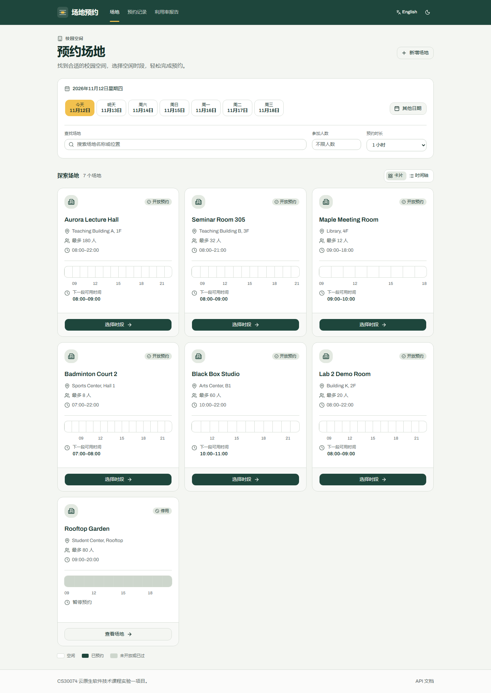
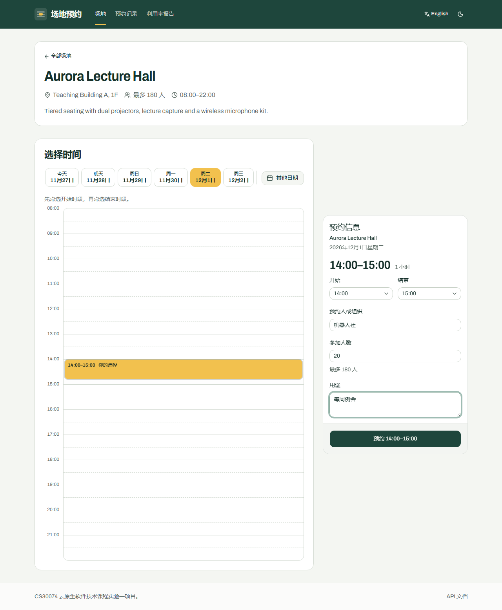
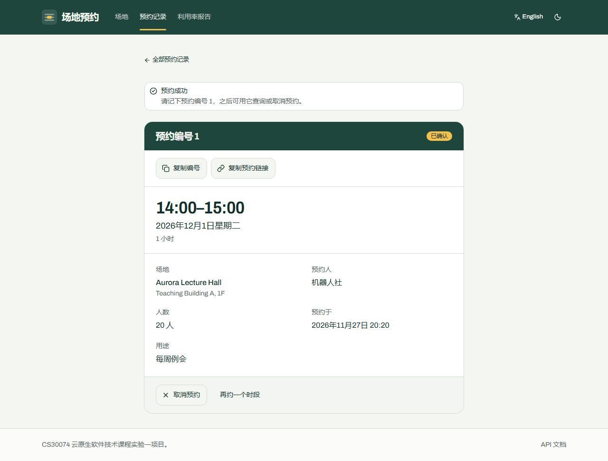
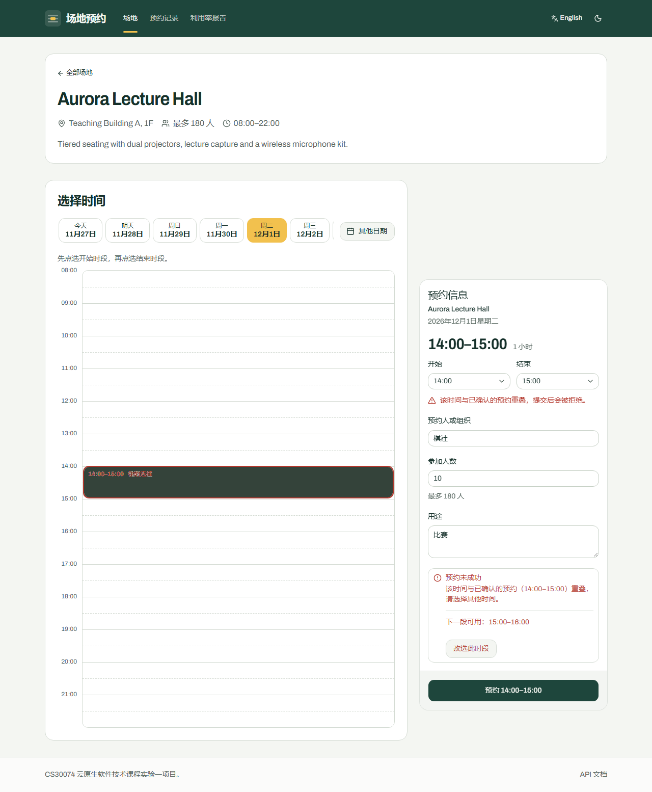
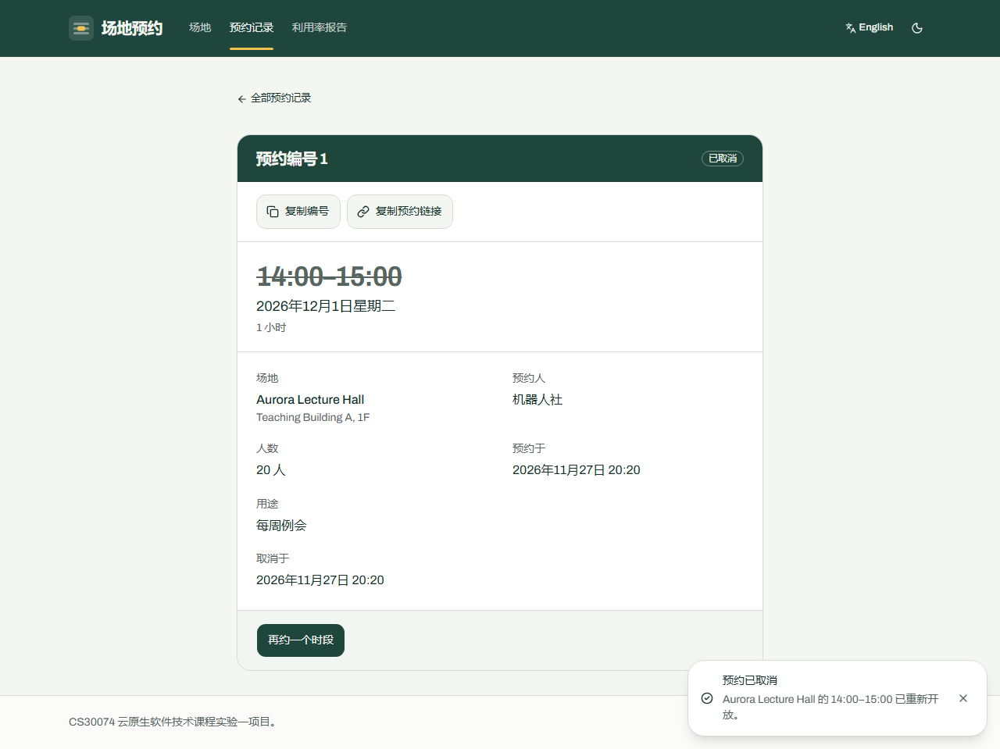
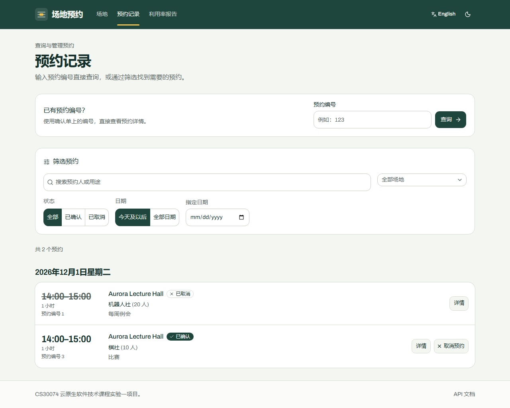
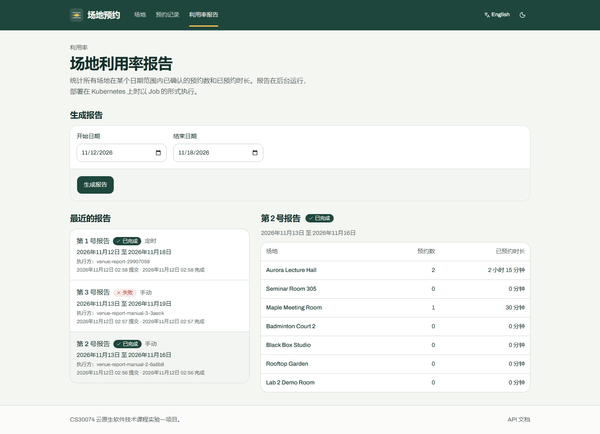
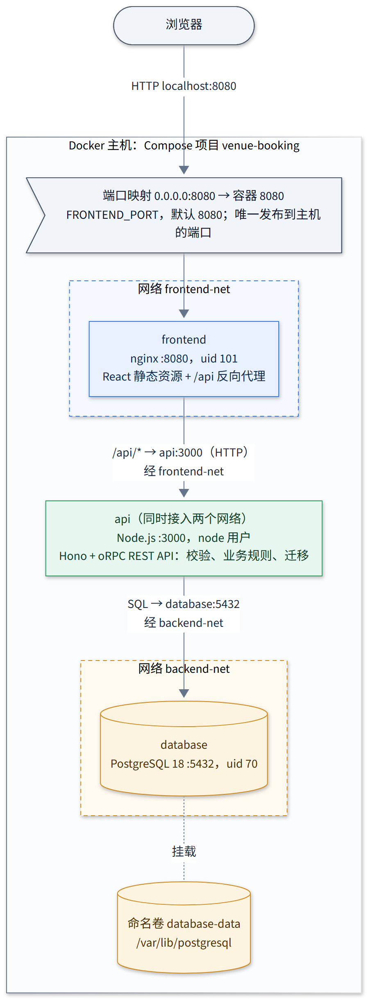
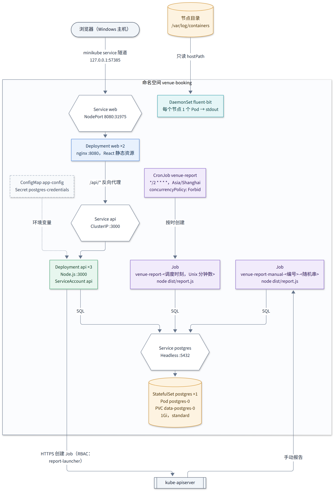

# 场地预约系统：Kubernetes 演示手册

演示内容：系统在 minikube 上的运行状态，预约成功、冲突拒绝、取消后重新预约等流程，以及各工作负载的运行情况。演示约 3 分钟，可以现场操作，也可以播放提前录制的演示视频。

## 1. 部署（约 6 分钟）

前提：启动 Docker Desktop，确认左下角显示 Engine running。在仓库根目录打开 PowerShell，依次执行以下命令，前一条执行完再执行下一条。

1. 新建干净的集群（约 2 分钟）。先删除旧集群，保证每次都从同样的状态开始：

   ```powershell
   minikube delete
   ```

   ```powershell
   minikube start
   ```

2. 构建前后端镜像并导入集群（约 1 分钟）。Compose 构建需要读取仓库根目录的 `.env`，文件已存在时第一条命令会直接跳过：

   ```powershell
   if (-not (Test-Path .env)) { Copy-Item .env.example .env }
   ```

   ```powershell
   $env:IMAGE_TAG="2.0.0"; docker compose build api frontend
   ```

   ```powershell
   minikube image load venue-booking/api:2.0.0 venue-booking/frontend:2.0.0
   ```

3. 准备数据库密码文件 `deploy/k8s/secret.env`（不提交到 Git）。文件已存在时这条命令会直接跳过：

   ```powershell
   if (-not (Test-Path deploy/k8s/secret.env)) { Copy-Item deploy/k8s/secret.env.example deploy/k8s/secret.env }
   ```

4. 部署全部资源并等待就绪（约 1 分钟）：

   ```powershell
   kubectl apply -k deploy/k8s
   ```

   ```powershell
   kubectl -n venue-booking rollout status deploy/api deploy/web sts/postgres
   ```

   演示前，清除部署期间产生的 Job：

   ```powershell
   kubectl -n venue-booking delete jobs --all
   ```

   定时报告每 2 分钟运行一次。如果某次运行赶在后端建好数据表之前，这个 Job 会失败（日志为 `42P01`，表不存在）；后端就绪后，后续定时运行都会成功。

5. 打开网站：
   - 把本机 18080 端口转发到 `web` Service。命令会弹出新窗口，演示期间不要关闭：

     ```powershell
     Start-Process kubectl -ArgumentList "-n venue-booking port-forward svc/web 18080:8080"
     ```

   - 等待转发就绪（约 10 秒）后用浏览器打开网站：

     ```powershell
     do { Start-Sleep 1 } until ((Test-NetConnection localhost -Port 18080 -WarningAction SilentlyContinue).TcpTestSucceeded); Start-Process http://localhost:18080
     ```

重新开始演示（清空所有预约）：关闭第 5 步弹出的窗口，从第 1 步重新执行。

演示结束后，执行 `minikube stop` 关闭集群。

## 2. 演示流程（约 3 分钟）

准备：最大化浏览器，确认网页是中文界面；如果是英文，点右上角切换为中文。

### 场景 1：系统运行在 Kubernetes 上（30 秒）

```powershell
kubectl -n venue-booking get deploy,sts,cronjob,ds,pod,svc,pvc
```

示例输出（节选）：

```text
NAME                  READY   UP-TO-DATE   AVAILABLE   AGE
deployment.apps/api   3/3     3            3           81s
deployment.apps/web   2/2     2            2           81s

NAME                        READY   AGE
statefulset.apps/postgres   1/1     81s

NAME                         SCHEDULE      TIMEZONE        SUSPEND   ACTIVE   LAST SCHEDULE   AGE
cronjob.batch/venue-report   */2 * * * *   Asia/Shanghai   False     0        37s             81s

NAME                        DESIRED   CURRENT   READY   UP-TO-DATE   AVAILABLE   NODE SELECTOR            AGE
daemonset.apps/fluent-bit   1         1         1       1            1           kubernetes.io/os=linux   81s

NAME               TYPE        CLUSTER-IP       EXTERNAL-IP   PORT(S)          AGE
service/api        ClusterIP   10.100.200.180   <none>        3000/TCP         81s
service/postgres   ClusterIP   None             <none>        5432/TCP         81s
service/web        NodePort    10.103.152.0     <none>        8080:31189/TCP   81s

NAME                                    STATUS   VOLUME     CAPACITY   ACCESS MODES   STORAGECLASS
persistentvolumeclaim/data-postgres-0   Bound    pvc-77a0…  1Gi        RWO            standard
```

讲解：「Lab 1 时，我们用 Docker Compose 运行三个容器。迁移到 Kubernetes 后，前端有 2 个副本，后端 3 个副本，数据库保持 1 个副本，另外新增了定时报告和日志采集。整个系统只有前端 `web` 通过 NodePort 对外开放，数据都保存在 PVC 绑定的持久卷里。」

### 场景 2：预约成功（30 秒）



1. 在预约看板中选择 Aurora Lecture Hall，再选一个晚于当天的日期（下文以 12 月 1 日为例，已经过去的时段不能选）。
2. 复制地址栏网址（包含日期），按 Ctrl+T 打开新标签页，粘贴并回车加载，供场景 3 演示冲突用。
3. 回到第一个标签页，在时间表上先点 14:00 那一格（14:00–14:30），再点下一格（14:30–15:00），选中 14:00 至 15:00。
4. 填写预约人「机器人社」、人数 20、用途「每周例会」，点「预约 14:00–15:00」。



页面显示「预约成功」和预约编号：



### 场景 3：冲突被拒绝（45 秒）

1. 切到第二个标签页。页面会重新读取预约数据，时间表上 14:00–15:00 显示为机器人社的预约，这一段不能再点选。
2. 在右侧「开始」下拉框选 14:00，「结束」下拉框选 15:00。页面提示「该时间与已确认的预约重叠，提交后会被拒绝。」，但仍允许提交。
3. 填写预约人「棋社」、人数 10、用途「比赛」，点「预约 14:00–15:00」。
4. 页面提示「预约未成功」，说明该时间与已确认的预约重叠，并给出「下一段可用：15:00–16:00」。



讲解：「前端虽然已经提示这个时段被占用了，但并没有禁用提交，最终由后端判断。我们照样点提交，后端马上就拒绝了。冲突检查是在数据库里完成的，不管请求落到 3 个后端副本里的哪一个，结果都一样。」

### 场景 4：取消后重新预约（45 秒）

1. 回到第一个标签页，点「取消预约」，在确认框中再点「取消预约」。状态变为「已取消」。

   

2. 切到第二个标签页，时间表上这一段恢复空闲。再点一次「预约 14:00–15:00」，这次预约成功。
3. 打开顶部「预约记录」：一条已取消，一条已确认。



预约编号从 1 跳到 3，因为被拒绝的那次提交也占用了编号 2。

### 场景 5：3 个后端副本共同处理请求（20 秒）

连续请求 30 次，统计各 Pod 的处理次数（后端每个响应都带 `X-Served-By` 头，值为处理该请求的 Pod 名称）：

```powershell
1..30 | % { (Invoke-WebRequest "http://localhost:18080/api/venues" -UseBasicParsing).Headers['X-Served-By'] } | Group-Object | Select Count,Name
```

示例输出：

```text
Count Name
----- ----
    8 api-cccdc8759-dlv9g
   12 api-cccdc8759-mp6mr
   10 api-cccdc8759-vw2g8
```

讲解：「这里连续发了 30 个请求，可以看到它们分散到了 3 个不同的后端 Pod 上，说明 3 个副本在共同分担流量。」

### 场景 6（可选）：Pod 被删除后自动恢复，数据保留（40 秒）

1. 删除数据库 Pod 并等待重建：

   ```powershell
   kubectl -n venue-booking delete pod postgres-0
   ```

   ```powershell
   kubectl -n venue-booking rollout status sts/postgres
   ```

2. 刷新「预约记录」，预约仍在。重建后的 Pod 名称仍是 `postgres-0`，并挂回同一个 PVC。
3. 删除一个 api Pod，再列出 Pod：

   ```powershell
   kubectl -n venue-booking delete (kubectl -n venue-booking get pods -l app.kubernetes.io/name=api -o name)[0] --wait=false
   ```

   ```powershell
   kubectl -n venue-booking get pods
   ```

4. 输出中，被删除的 Pod 处于终止状态（Terminating），Deployment 已创建新的 api Pod，维持 3 个副本。

### 场景 7（可选）：Job 和 CronJob（30 秒）

1. 打开顶部「利用率报告」，确认日期范围包含场景 2 的预约日期（默认是今天起的 7 天），点「生成报告」。
2. 状态从「等待中」变为「已完成」，页面显示各场地的预约次数和时长。



3. 查看 Job：

   ```powershell
   kubectl -n venue-booking get jobs
   ```

   `venue-report-manual-…` 是网页触发的 Job，`venue-report-<数字>` 是 CronJob 每 2 分钟创建的 Job。

## 3. 汇报结构（10 分钟）

| 时间 | 内容 |
| ---- | ---- |
| 0:00 | 系统简介：浏览场地、预约时段、拒绝重叠预约、取消预约。Lab 1 用 Docker Compose，Lab 2 用 Kubernetes |
| 1:00 | 从 Compose 迁移到 Kubernetes：对照表和架构图 |
| 2:30 | 工作负载选型 |
| 4:00 | 演示（第 2 节） |
| 7:00 | 遇到的问题及解决过程 |
| 8:30 | 成员分工 |
| 9:00 | 总结与提问 |

汇报后的课堂讨论见第 6 节。

### 架构：迁移前后

迁移前（Lab 1，Docker Compose）：三个容器在同一台 Docker 主机上，通过服务名 `api`、`database` 互相访问，只对外开放前端的 8080 端口。



迁移后（Lab 2，Kubernetes）：每个服务对应一个工作负载和一个 Service，新增报告 Job、CronJob 和日志采集 DaemonSet。



### Compose 与 Kubernetes 对照

| Lab 1（Compose） | Lab 2（Kubernetes） | 原因 |
| ---------------- | ------------------- | ---- |
| `frontend` 服务 | `web` Deployment，2 副本，NodePort Service | 外部唯一入口 |
| `api` 服务 | `api` Deployment，3 副本，ClusterIP Service | 只在集群内访问，前端把 `/api` 转给它 |
| `database` 服务和数据卷 | `postgres` StatefulSet，1 副本，1Gi PVC，Headless Service | Pod 名称固定，重建后挂回原来的持久卷 |
| `.env` 文件 | ConfigMap 存普通配置，Secret 存密码 | 密码不写进 YAML 和镜像 |
| 无 | Job、CronJob、DaemonSet | Lab 2 新增的报告功能和日志采集 |

镜像沿用 Lab 1 的 Dockerfile 构建，版本为 2.0.0。Lab 2 新增的代码主要实现报告功能，并在响应头中加入 `X-Served-By` 标识处理请求的 Pod。迁移到 Kubernetes 只新增了 `deploy/k8s/` 下的清单，没有改动 Lab 1 已有的业务代码和 Compose 配置。

### 工作负载选型

| 组件 | 工作负载 | 理由 |
| ---- | -------- | ---- |
| 后端 API | Deployment ×3 | 无状态，副本之间完全相同，可以随时替换和扩缩 |
| 前端 nginx | Deployment ×2 | 无状态，提供静态页面，并把 `/api` 请求反向代理到后端 |
| PostgreSQL | StatefulSet ×1 | 需要固定名称 `postgres-0` 和独立磁盘，重启后数据保留 |
| 手动报告 | Job | 运行一次就结束，Kubernetes 记录成功或失败 |
| 定时报告 | CronJob | 由 Kubernetes 按计划启动；如果放在 API 进程里，3 个副本会各触发一次 |
| 日志采集 Fluent Bit | DaemonSet | 日志存在各节点本地，每个节点需要运行一个采集 Pod |

后端不在内存中保存业务数据，可以直接增加副本。数据库如果直接增加副本，各副本使用各自的磁盘，数据互不同步；支持多副本需要额外配置主从复制，因此这里保持单副本。

## 4. 遇到的问题

### 迁移后网页连不上后端

1. 前端 nginx 把 `/api/...` 请求转发给后端。Compose 中后端服务名是 `api`，nginx 配置为 `http://api:3000`。
2. Lab 1 曾遇到一个问题：nginx 只在启动时解析一次，重启后端容器后仍向旧容器的 IP 发请求。解决办法是启用 nginx 内置解析器，收到请求时再重新解析 `api`（结果缓存 10 秒）。
3. 迁移到 Kubernetes 后，所有加载数据的接口都返回 502 Bad Gateway，nginx 日志如下：

   ```text
   [error] api could not be resolved (2: Server failure)
   ```

4. 原因：在 Kubernetes 中，短域名 `api` 靠 DNS 搜索域补全为 `api.venue-booking.svc.cluster.local`。nginx 内置解析器不读取搜索域，直接查询 `api`，解析失败。
5. 解决：在 `deploy/k8s/web.yaml` 中把后端地址改为完整域名 `http://api.venue-booking.svc.cluster.local:3000`。只改一行配置，镜像和 Compose 文件不变，Lab 1 的部署照常可用。

讲解：「迁移到 Kubernetes 后，所有接口都返回 502。查看 nginx 日志，发现它解析不了 `api` 这个服务名。原因是 Kubernetes 的短域名要靠 DNS 搜索域补全，nginx 内置解析器不会补全。最后我们在 Kubernetes 配置里改用完整域名，只改了一行配置，镜像不用重新构建。」

### PostgreSQL 18 数据目录变更

PostgreSQL 18 官方镜像把数据目录从 `/var/lib/postgresql/data` 改到了 `/var/lib/postgresql/18/docker`。数据卷如果仍挂在旧路径，数据会写入容器可写层，Pod 重建后就会丢失。把挂载路径改为 `/var/lib/postgresql` 后，即使删除 `postgres-0`（如场景 6 所示），预约数据仍然保留。

完整的问题记录见 `docs/lab-2-report.md` 第 4.2 节和 `docs/lab-1-report.md` 第 11 节。

## 5. 成员分工

Lab 2（出自 `docs/lab-2-report.md` 第 4.1 节）：

| 成员 | 负责内容 |
| ---- | -------- |
| 彭知书 | 后端报告功能：接口契约、`reports` 表、聚合查询、报告任务入口、通过 Kubernetes API 创建和查询 Job、查询时对账、多副本的实例标识 |
| 黄泓力 | 前端报告页面：日期表单与校验、报告列表与结果表、状态轮询、失败提示、中英文文案、手机布局；报告页面的端到端测试 |
| 郑皓名 | Kubernetes 清单与部署：StatefulSet 与 PVC、Service、ConfigMap 和 Secret、探针与资源配置、CronJob、Fluent Bit DaemonSet、RBAC；在 minikube 上部署并验证 |

Lab 1（出自 `docs/lab-1-report.md` 第 10 节）：

| 成员 | 负责内容 |
| ---- | -------- |
| 彭知书 | 后端 Web API 与业务规则：场地和预约的增删查、参数校验、停用场地、开放时间、过去时间、容量和冲突；统一的 JSON 错误，不返回堆栈 |
| 黄泓力 | 前端交互：预约看板、场地页、预约表单、预约记录和中英文界面；已过的开始时间在时间表和下拉框里置灰且不可选；冲突只作提示，最终仍交给 API |
| 郑皓名 | 数据库与容器化：表结构、迁移、排他约束、演示数据；前端和 API 的 Dockerfile；Compose 的网络、卷、健康检查和环境变量；部署与持久化记录 |

## 6. 课堂讨论：后端拆分为微服务

第 12 周课程笔记中的讨论主题：在现有 Lab 的基础上扩展需求后，后端如何按业务能力或 DDD 拆分为微服务，以及拆分后的架构。

### 现状：容器化的单体

| 部分 | 现状 |
| ---- | ---- |
| `web` | nginx，提供前端页面，并把 `/api` 反向代理到后端 |
| `api` | 一个 Node.js 程序，包含场地、预约、报告三组接口 |
| `postgres` | 一个数据库，场地、预约、报告三张表都在里面 |

前端、后端、数据库是按技术层次划分的。微服务按业务能力拆分，每个服务有独立数据库，可以独立部署和扩缩容。目前 `api` 的 3 个副本复制的是整个后端，属于扩展立方体（Scale Cube）的 X 轴扩展；拆分为微服务属于 Y 轴扩展（按功能分解）。

讲解：「系统虽然跑在多个容器里，但后端还是一个单体，场地、预约、报告都在同一个程序里，共用一个数据库。3 个副本只是把整个后端复制了 3 份，属于 X 轴扩展，还不算微服务。」

### 拆分方案：按业务能力拆成三个服务

现有接口已按 `/venues`、`/reservations`、`/reports` 分为三组，拆分时沿用这一边界：

| 服务 | 负责 | 数据库 | 工作负载 |
| ---- | ---- | ------ | -------- |
| 场地服务 | 场地信息、开放时间、容量、停用 | 场地库 | Deployment，1～2 个副本 |
| 预约服务 | 创建、查询和取消预约，冲突检查 | 预约库，保留排他约束 | Deployment，副本数可单独调高 |
| 报告服务 | 利用率报告 | 报告库 | Deployment，报告计算继续用 Job 和 CronJob |

`web` 中的 nginx 改为 API 网关，按路径把 `/api/venues`、`/api/reservations`、`/api/reports` 转发给对应服务的 Service。

需求扩展后还可以继续增加服务，例如由用户服务负责账号和登录，由通知服务订阅预约事件并给预约人发邮件。

### 拆分后要修改的三处

现在三张表在同一个数据库里，代码可以直接关联查询。拆分后要改以下三处：

1. 预约时检查场地
   - 现在：创建预约时，在同一个事务（transaction）里先锁住该场地的记录，让同一场地的预约依次处理，再检查场地是否停用、是否在开放时间内、人数是否超出容量，最后插入预约。查询和取消预约时，也通过关联场地表取得场地名称和位置。
   - 拆分后：场地数据归场地服务管理，预约服务有两种做法：
     - 每次预约时同步调用场地服务的 REST 接口。实现简单，但场地服务不可用时无法预约。
     - 场地信息变化时由场地服务发布事件，预约服务订阅并在本地维护一份场地数据副本。预约和查询不依赖场地服务实时在线，代价是本地数据会有短暂延迟。
   - 同一场地的预约仍需依次处理，锁改在预约服务自己的数据库里实现。
2. 外键
   - 现在：预约表通过外键（foreign key）引用场地表，由数据库保证每条预约对应的场地都存在。
   - 拆分后：两张表位于不同数据库，不能再用外键，改由预约服务在预约时确认场地存在。
3. 报告统计
   - 现在：报告用一条 SQL 关联场地表和预约表，统计每个场地的预约次数和时长，没有预约的场地也会列出。
   - 拆分后：报告服务不能直接查询另外两个服务的数据库，只能分别调用场地服务和预约服务的接口获取数据后再汇总。这种做法称为 API 组合模式（API Composition）。

拆分后的一致性分两种情况：

- 强一致（strong consistency）：冲突检查留在预约服务内部，继续由预约库的排他约束（exclusion constraint）保证。不管拆成多少个服务，同一场地的同一时段都只能有一条有效预约。
- 最终一致（eventual consistency）：场地数据副本采用最终一致。以后支持修改已有场地状态（例如停用）时，预约服务在收到变更通知前仍可能接受该场地的新预约，需要通过业务手段补救（如通知预约人改期）。

### 什么时候拆分

讲解：「我们的系统规模还小，需求也在变。按课上讲的，这个阶段用单体更合适，拆成微服务反而会在网络调用、数据一致性和运维上增加不少成本。等业务稳定下来、单体越来越难维护的时候，再按业务能力拆出场地、预约、报告服务，把用户账号和通知也做成独立服务。」

## 7. 常见问题

| 问题 | 回答 |
| ---- | ---- |
| 前端为什么用 NodePort，不用 Ingress？ | `web` 中的 nginx 已经负责反向代理 `/api`，系统只需要一个对外入口，在 minikube 上用 NodePort 即可 |
| 为什么演示时用 port-forward 访问？ | minikube 用 Docker 驱动时，Windows 主机访问不到节点 IP，无法直接访问 NodePort，因此用 port-forward 把 `web` Service 的 8080 端口转发到本机 |
| 怎样证明 3 个后端副本都在处理请求？ | 看响应头 `X-Served-By`（场景 5）和各 Pod 日志 |
| 3 个副本同时处理，为什么不会重复预约？ | 数据库用排他约束禁止时间重叠的预约，与哪个副本处理无关 |
| 密码存在哪里？ | 存在 Kubernetes Secret 中，由 `deploy/k8s/secret.env` 生成，该文件不提交到 Git |
| 数据库 Pod 故障后数据怎么办？ | 数据保存在 PVC 绑定的持久卷中，StatefulSet 重建 `postgres-0` 后会重新挂载该卷（场景 6） |
| 预约编号为什么跳号？ | PostgreSQL 的自增序列在插入时分配编号，插入因冲突被拒绝后编号不会回收 |
| CronJob 为什么每 2 分钟运行一次？ | 便于演示。正式环境为每天一次（`5 0 * * *`） |

## 8. 故障排查

| 现象 | 处理 |
| ---- | ---- |
| `docker` 或 `minikube` 报 pipe、cannot connect | Docker Desktop 未启动，先启动 |
| `minikube start` 报 `K8S_APISERVER_MISSING` | 执行 `minikube delete`，再执行 `minikube start` |
| Pod 状态为 `ErrImagePull` 或 `ImagePullBackOff` | 补执行第 1 节第 2 步的 `minikube image load`，再执行 `kubectl -n venue-booking delete pod --all` |
| 网站打不开 | 第 1 节第 5 步弹出的窗口已关闭，重新执行第 5 步的两条命令 |
| 查看出错原因 | 先执行 `kubectl -n venue-booking get pods`，再执行 `kubectl -n venue-booking describe pod <Pod名>` |

部署文件的详细说明见 `deploy/k8s/README.md`。
